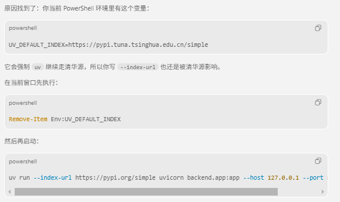

# SuperMew 项目说明

## 开发检查与按需加载

自动回归测试保留在 `test/`，统一使用 `python -m pytest`；配置会自动补齐模块搜索路径，隔离真实数据库和文件目录，阻断外部网络及真实向量模型初始化。测试收集和执行不读取本机 `.env`，需要模型的自动用例应注入假模型。真实模型、搜索、OCR、专业数据库及 LangSmith 工具统一移到 `scripts/manual/`，按需手工运行；这类验收可能调用外部服务或消耗额度。

```powershell
# 默认自动回归，不执行手工验收工具
.\.venv\Scripts\python.exe -m pytest -q
# 前端回归
node test/frontend_markdown.cjs
node test/frontend_home.cjs
node test/frontend_accounts.cjs
node test/frontend_industry_params.cjs
node --test test/company-knowledge-ui.test.cjs
# 隔离浏览器验证 HTML 净化（复用本机测试资源缓存）
.\.venv\Scripts\python.exe scripts/check-markdown-ui.py --assets-dir work/account-ui/vendor
# 查看手工工具参数，不执行模型或评测
.\.venv\Scripts\python.exe scripts/manual/check_embedding.py --help
.\.venv\Scripts\python.exe scripts/manual/evaluate_langsmith.py --help
```

账号 PostgreSQL 集成用例仍使用独立临时 schema。显式设置 `ACCOUNT_TEST_POSTGRES=1` 并在运行 pytest 前加载数据库连接配置；远程服务验证还须显式传入 `--allow-network`。默认自动回归不会连接部署的 PostgreSQL、Redis 或 Milvus。

向量模型和 `langchain_huggingface` 改为首次非空稠密向量请求时加载，同一进程的并发请求共享一次初始化；加载失败可在修复配置后重试。登录、个人首页、账号管理及 BM25 稀疏统计无需初始化稠密模型。模型、向量维度和已有统计格式保持兼容。

AI 助手的 Markdown 输出统一经过 HTML 净化，保留标题、列表、表格、代码及安全链接；净化库或解析器不可用时显示转义文本。DOMPurify `3.4.17` 随项目本地部署，来源为[官方固定版本](https://github.com/cure53/DOMPurify/tree/3.4.17)，许可证位于 `frontend/vendor/DOMPurify-LICENSE.txt`。净化库文件 SHA-256 为 `cd37898f9782adf54820c413191b5691803f0f137c799d6edcfd38523b4c2c31`。

手工工具按用途分组：`check_search.py`、`check_bocha.py`、`check_serper.py` 检查搜索；`check_ocr.py`、`check_tencent_ocr.py`、`check_vision.py` 检查 OCR/视觉；`check_qcc_mcp.py`、`check_tyc_mcp.py`、`check_xiniu_mcp.py` 检查专业数据库；`diagnose_cleaning.py`、`trace_cleaning.py` 检查清洗流程；`check_embedding.py`、`evaluate_langsmith.py` 检查真实模型和评测。移动后统一从项目根目录读取配置。

## 邀请注册与账号管理

登录后默认进入个人首页，查看本人的任务概况、最近报告与快捷入口；使用说明及隔离测试见 [个人首页说明](docs/PERSONAL_HOME.md)。

个人首页的最近成果、任务展开后的成果下载区均提供“历史版本”。研究报告和建议书分别按“记录 001、记录 002……”展示，支持分页、查看保存时间与生成方式、预览和下载指定旧稿；内部版本号及原文件保持沿用。列表不返回正文和存储路径，预览沿用 HTML 净化并限制显示长度，原有复核提示保持显示。未记录细分生成方式的历史数据不补造来源。入口只读，继续沿用项目访问权限，不修改报告或复核状态。隔离验证可运行 `node test/frontend_report_versions.cjs`、`python -m pytest test/test_report_versions.py -q` 及 `python scripts/check-report-versions-ui.py`（浏览器脚本使用本地缓存资源）。

账号通过管理员发放的限时邀请码注册，分普通账号与管理员两种类型，默认6小时有效，过期自动清理并保留日志；已有完整邀请链接仍兼容。管理员进入“账号管理”可筛选账号、编辑姓名和备注、启停用、重置密码、授权公司知识库、提升或降级角色，并查询操作日志。敏感操作须再次验证密码，至少保留一个启用的管理员，并有数据库登录限流。已有部署须执行增量迁移，使用与部署步骤见 [账号管理说明](docs/ACCOUNT_MANAGEMENT.md)。

## 公司知识库（百炼托管 RAG）

「公司知识库」菜单已接入百炼云端文档列表、流式问答、引用片段和返回的原件链接。资料上传与更新目前在百炼控制台进行；接入配置、员工授权和当前功能范围见 [公司知识库接入说明](docs/COMPANY_KNOWLEDGE.md)。

Agent的项目记录，方便后续持续更新与展示。

## 当前 Windows 环境启动（2026-10-14 验证）

在当前项目根目录（本机为 `E:\projects\RAG`）执行：

```powershell
powershell -ExecutionPolicy Bypass -File .\scripts\start-local.ps1 -Background
.\.venv\Scripts\python.exe .\scripts\check-local.py
```

页面：`http://127.0.0.1:8010/`；API 文档：`http://127.0.0.1:8010/docs`。
不传 `-Background` 时后端在当前终端运行，可用 Ctrl+C 停止。

本机 `.venv` 已从 `E:\RAG.zip` 恢复并绑定可用的 Python 3.12.14，模型路径已迁移到当前目录。
本地模型是 BGE-small-zh，输出 512 维；`.env` 中的 `DENSE_EMBEDDING_DIM` 必须与模型和集合一致。
启动脚本自动识别其他目录部署的健康 Milvus、MinIO、etcd 并复用，仅启动本项目的 PostgreSQL 和 Redis。
也可显式传入 `-ReuseVectorServices`。后台模式会等待后端 API 就绪后再报告成功。
新机器仍需自行安装 Python 依赖并配置 `.env`，这些运行文件不提交到 Git。
原 MinIO 镜像无法下载，`docker-compose.override.yml` 改为从
[同版本官方源码](https://github.com/minio/minio/tree/RELEASE.2024-05-28T17-19-04Z)构建本地镜像。
MinIO 构建文件位于 `docker/minio`，源码归档首次缺失时启动脚本会下载并校验。
后台日志位于 `work/environment-recovery`。连通性检查不会创建或重跑研究项目。

### 本地管理员与公司流程验证

```powershell
# 创建管理员：交互输入密码（至少8位，含字母和数字），不会改动已有同名账号
.\.venv\Scripts\python.exe .\scripts\create-admin.py --username admin

# 实际登录并运行公司研究，保存 trace 和两份 Word 下载结果
.\.venv\Scripts\python.exe .\scripts\smoke-research.py --username admin --company "比亚迪股份有限公司"
```

脚本也支持通过 `BOOTSTRAP_ADMIN_PASSWORD` 环境变量传入密码；不要把真实密码提交到仓库。
本次创建的管理员凭据保存在本机忽略目录 `work/local-admin.json`。
流程验证日志保存在 `work/smoke-research/`，检查记录见 [本地运行验证记录](docs/LOCAL_RUN_CHECK_2026-10-14.md)。

## 行业研究线路

选择 `CDD目标行业报告`，填写行业名称、重点赛道、排除范围、研究地域、数据截止日和研究用途。
截止日独立于任务结束时间；默认地域和截止日会在报告研究边界中说明。
填写核心企业名称后才启用企业公开资料尽调。资本市场开关控制一级融资、IPO、估值及二级市场研究。

行业报告采用参照模板的 16 章目录，技术路线独立成章，来源和后续研究点分别为第 15、16 章。
建议书采用 7 章结构，人员、周期和报价保留为双方确认项。
行业结论与企业样本分开；无有效证据的评分为 `unknown`，数值口径不完整时需核验。
任务生成完成后还应查看报告是否为待复核稿，以及 Word 导出和版式检查状态。

行业范围变更会使对应缓存失效，历史来源仍保留。默认检索查询预算为 80，可通过
`INDUSTRY_SEARCH_QUERY_BUDGET` 在 10 至 200 之间调整。
新逻辑集中在 `backend/industry_research.py` 和行业策略、报告 Agent 中。
详细范围与验证见 [行业优化计划](docs/industry_optimization_plan.md)。

```powershell
$env:PYTHONPATH = (Resolve-Path backend).Path
.\.venv\Scripts\python.exe -m pytest test/test_json_output.py test/test_industry_scope.py test/test_industry_evidence.py test/test_industry_api_intake.py -q
node test/frontend_industry_params.cjs
```

## 本地部署

### 1) 环境准备
- Python `3.12+`
- 包管理建议：`uv`（也支持 `pip`）
- Docker / Docker Compose（用于启动 Milvus 依赖）

### 2) 使用 pyproject 安装依赖
在项目根目录执行：

```bash
# 方式 A：推荐（uv）
uv sync

# 运行服务
uv run python backend/app.py
# 或
uv run uvicorn backend.app:app --host 127.0.0.1 --port 8010 --reload
```

```bash
# 方式 B：pip
python -m venv .venv
source .venv/bin/activate
pip install -U pip
pip install -e .

# 运行服务
python backend/app.py
# 或
uvicorn backend.app:app --host 0.0.0.0 --port 8000 --reload
uv run uvicorn backend.app:app --host 127.0.0.1 --port 8010 --reload
```

### 3) 创建 `.env` 文件
在项目根目录新建 `.env`，可直接使用下面模板：

```env
# ===== Model =====
ARK_API_KEY=your_ark_api_key
MODEL=your_model_name
BASE_URL=https://your-llm-endpoint/v1

# ===== 本地稠密向量（langchain_huggingface，默认 BAAI/bge-m3）=====
EMBEDDING_MODEL=BAAI/bge-m3
EMBEDDING_DEVICE=cpu
DENSE_EMBEDDING_DIM=1024

# ===== Rerank (可选，不配则自动降级) =====
RERANK_MODEL=your_rerank_model
RERANK_BINDING_HOST=https://your-rerank-host
RERANK_API_KEY=your_rerank_api_key

# ===== Milvus =====
MILVUS_HOST=127.0.0.1
MILVUS_PORT=19530
MILVUS_COLLECTION=embeddings_collection

# ===== Database / Cache =====
DATABASE_URL=postgresql+psycopg2://<db_user>:<db_password>@<db_host>:5432/<db_name>
REDIS_URL=redis://127.0.0.1:6379/0

# ===== Auth =====
JWT_SECRET_KEY=generate_a_random_secret_locally
JWT_ALGORITHM=HS256
JWT_EXPIRE_MINUTES=1440
PASSWORD_PBKDF2_ROUNDS=310000

# ===== BM25 稀疏统计持久化（默认 data/bm25_state.json，可改路径）=====
# BM25_STATE_PATH=/path/to/bm25_state.json

# ===== Tools （可选）=====
AMAP_WEATHER_API=https://restapi.amap.com/v3/weather/weatherInfo
AMAP_API_KEY=your_amap_api_key

```

### 4) Docker 部署（数据库 + 缓存 + 向量库）
当前仓库的 `docker-compose.yml` 同时承载业务依赖与 Milvus 依赖：
- 业务依赖：`postgres`、`redis`
- 向量依赖：`etcd`、`minio`、`standalone`、`attu`

```bash
# 启动向量库依赖
docker compose up -d

# 查看服务状态
docker compose ps

# 查看日志（可选）
docker compose logs -f standalone
```

端口说明：
- PostgreSQL：`5432`
- Redis：`6379`
- Milvus：`19530`
- Milvus 健康检查：`9091`
- MinIO API：`9000`
- MinIO Console：`9001`
- Attu：`8080`

### 5) 启动应用并访问
在 Milvus 启动后，运行后端应用：

```bash
uv run uvicorn backend.app:app --host 0.0.0.0 --port 8000 --reload
```

浏览器访问：
- 前端页面：`http://127.0.0.1:8000/`
- API 文档：`http://127.0.0.1:8000/docs`

## 项目概览
- **核心能力**：
  - LangChain Agent + 自定义工具。
  - 文档上传后执行三级滑动窗口分块，叶子分块向量化写入 Milvus，父级分块写入 PostgreSQL。
  - 用户注册/登录、JWT 鉴权、基于角色的 RBAC 权限控制（admin/user）。
  - 会话记忆与摘要，聊天与历史记录落地 PostgreSQL，并引入 Redis 缓存热点会话与父文档。
- **运行形态**：FastAPI 后端 + 纯前端（Vue 3 CDN 单页）+ Milvus 向量库。

## 关键创新点
- **混合检索落地**：稠密向量 + BM25 稀疏向量，Milvus Hybrid Search + RRF 排序，兼顾语义与词匹配。
- **Jina Rerank 接入**：Hybrid/Dense 召回后进行 API 级精排，支持返回 `rerank_score` 并在前端可视化。
- **双向降级**：稀疏生成或 Hybrid 调用失败时自动降级为纯稠密检索，提升稳定性。
- **流式输出（Streaming）**：后端基于 `agent.astream(stream_mode="messages")` 逐 token 推送，前端 SSE + ReadableStream 实现打字机效果。
- **实时 RAG 过程可视化**：检索过程在模型"思考中"阶段就开始展示，通过 `asyncio.Queue` + 后台任务架构实现工具执行期间的实时推送。
- **回答终止功能**：前端 `AbortController` + 后端 `StreamingResponse` 支持用户随时中断正在生成的回答。
- **会话摘要记忆**：自动摘要旧消息并注入系统提示，维持上下文且控制 token。
- **文档处理链路**：上传 → 切分 → 稠密/稀疏向量同步生成 → Milvus 入库，支持重复上传自动清理旧 chunk。
- **BM25 统计持久化**：`词表 + 文档频次 df + 文档数 N` 落盘到 `data/bm25_state.json`，入库时增量增加、删除/覆盖上传前按文件名从 Milvus 拉取 chunk 文本后增量扣减，与向量库同步；`embedding_service` 在 API 与检索模块间单例共享。
- **三级分块 + Auto-merging**：L1/L2/L3 三层滑窗切分；检索时优先召回 L3，满足阈值后自动合并到父块（L3->L2->L1）。
- **Leaf-only 向量化存储**：仅叶子分块写入 Milvus，父块写入 DocStore，减少向量冗余并保留上下文聚合能力。
- **工具可扩展**：天气查询示例 + 知识库检索，便于按需增添第三方 API 或企业数据源。
- **RAG 过程可观测**：记录检索、评分、重写与来源信息，前端可展开查看每一步细节。
- **查询重写体系**：Step-Back 与 HyDE 两种扩展方式 + 路由选择，必要时触发重写检索。
- **相关性评分门控**：基于结构化输出的 `grade_documents` 判断是否需要重写检索。
- **实时思考链路展示**：通过 `asyncio` 事件循环穿透技术，实现 Agent 在执行 RAG、评分、重写等同步工具时，实时向前端推送思考步骤（Searching -> Grading -> Rewriting），彻底解决"静默思考"问题。

## 未来迭代（Todo Lists）

### RAG部分

#### 数据层、Chunk分块

1. 先做文档结构解析，按文档结构做粗拆分，再用递归字符分块兜底，保证打的主题单元不被拆分（2000-3000token）；再用语义分块做精细化拆分，控制单块大小（512-1024token）
2. 代码块、表格、图片特殊处理
3. 实现 ParentDocument/Auto-merging Retriever 策略 --done

#### 召回层

1. BM25的k1和b新增参数扫描
2. RRF额外做BM25和dense的权重，可以通过AB test确定
3. 做一个小型标注集比较dense only、sparse only、hybrid、hybrid + rerank的gold chunk

#### 生成层

1. 子问题分解（CoT、专门的分解小模型、判断分几个子问题）
2. 多文档Refine（一次拼接、串行Refine）
3. 多文档冲突处理（A文档说X，B文档说非X），回答中显式输出“来源存在冲突”

#### 其他

1. 向量嵌入：新增多模态 embedding 能力
2. 搭建 RAG 评估体系
3. Rerank 策略评估（top_k、candidate_k、召回/精排比例）

### 其他能力拓展

1. 开发 SQL assistant Skill
2. 实现暂停功能与人工介入机制 --done
3. 新增问题类型判断，简单问题跳过复杂处理流程
4. 扩展网络搜索能力
5. 支持多步骤规划与任务并行执行
6. 搭建路由器节点，由 LLM 自主判断下一步动作
7. 优化 memory 管理：集成 MemO、LangMem 等方案
8. multi-agent：工具过多，把工具拆分给职责明确的专业化agent，提升工具选择的准确性和整体稳定性
9. 历史记录会话名称可修改
10. 死循环检测与恢复：_is_stuck + attempt_loop_recovery

### 后端服务建设（本轮已完成）

1. 账号体系与权限体系
- 新增注册登录接口：`/auth/register`、`/auth/login`。
- 新增用户信息接口：`/auth/me`。
- 引入 JWT 鉴权中间能力：请求通过 Bearer Token 识别当前用户。
- 权限隔离：
  - `admin`：可执行文档上传、删除、文档列表查询。
  - `user`：仅可聊天、查询和删除自己的会话历史。

2. 数据库建模与持久化迁移
- 使用 SQLAlchemy 建立核心模型：`User`、`ChatSession`、`ChatMessage`、`ParentChunk`。
- 聊天历史由本地 JSON 迁移到 PostgreSQL。
- 父级分块文档（L1/L2）由本地 JSON 迁移到 PostgreSQL。

3. Redis 缓存策略
- 会话消息缓存：按 `user + session` 维度缓存消息列表。
- 会话列表缓存：按 `user` 维度缓存会话摘要列表。
- 父文档缓存：按 `chunk_id` 缓存父级分块内容。
- 写入/删除后执行缓存失效，保证一致性。

4. 密码安全与兼容
- 新注册用户采用 PBKDF2-SHA256 存储密码哈希（避免 bcrypt 后端兼容问题）。
- 登录校验兼容历史 bcrypt 哈希，支持平滑迁移。

## 目录与架构
- 后端：`backend/`
  - [app.py](backend/app.py)：FastAPI 入口、CORS、静态资源挂载。
  - [api.py](backend/api.py)：聊天、会话管理、文档管理接口。
  - [auth.py](backend/auth.py)：注册登录、JWT 鉴权、权限检查、密码哈希与校验。
  - [database.py](backend/database.py)：数据库引擎与会话工厂、建表入口。
  - [models.py](backend/models.py)：ORM 模型定义（用户、会话、消息、父文档）。
  - [cache.py](backend/cache.py)：Redis JSON 缓存封装。
  - [agent.py](backend/agent.py)：LangChain Agent、会话存储、摘要逻辑。
  - [tools.py](backend/tools.py)：天气查询、知识库检索工具。
  - [embedding.py](backend/embedding.py)：本地 HuggingFace 稠密向量（默认 `BAAI/bge-m3`）+ BM25 稀疏向量；BM25 状态持久化与增量更新。
  - [document_loader.py](backend/document_loader.py)：PDF/Word 加载与分片。
  - [parent_chunk_store.py](backend/parent_chunk_store.py)：父级分块仓储（PostgreSQL + Redis，用于 Auto-merging 回取父块）。
  - [milvus_writer.py](backend/milvus_writer.py)：向量写入（稠密+稀疏）。
  - [milvus_client.py](backend/milvus_client.py)：Milvus 集合定义、混合检索；`query_all` 分页查询（单次 `query` 的 `limit` 受服务端上限约束，删除前拉全量 chunk 文本时使用）。
  - [schemas.py](backend/schemas.py)：Pydantic 请求/响应模型。
- 前端：`frontend/`
  - [index.html](frontend/index.html) + [script.js](frontend/script.js) + [style.css](frontend/style.css)：Vue 3 + marked + highlight.js，提供聊天、历史会话、文档上传/删除界面。
- 数据：`data/`
  - `bm25_state.json`：BM25 词表与 `doc_freq` / `total_docs` 等统计（稀疏检索 IDF 与入库、删除同步）。
  - `documents/`：上传文档原文件。
- 向量库：Milvus（可由 `docker-compose` 或自建服务提供）。

## 核心流程

### 1) 项目全链路（端到端）
1. 用户在前端输入问题，调用 `POST /chat/stream`（流式）。
2. FastAPI `api.py` 返回 `StreamingResponse(media_type="text/event-stream")`。
3. LangChain Agent 根据问题类型决定是否调用工具：
  - 天气问题 → `get_current_weather`
  - 知识问答 → `search_knowledge_base`
4. 若命中知识库工具，进入 `rag_pipeline.py` 执行检索工作流，各阶段通过 `emit_rag_step()` 实时推送到前端。
5. 检索结果与 RAG Trace 一起返回，Agent 流式生成最终回答（逐 token 推送）。
6. 前端 ReadableStream 逐块解析 SSE，打字机效果实时渲染。
7. 同时消息持久化到 PostgreSQL，并通过 Redis 缓存加速历史会话回放。

### 2) RAG 全链路（重点）
1. **初次召回**：`retrieve_initial`
  - 调用 `retrieve_documents`。
  - 先按 `chunk_level == 3` 执行 Milvus Hybrid 检索（Dense + Sparse + RRF）。
  - 取更大候选集后走 Jina Rerank 精排。
  - 对召回叶子块执行 Auto-merging（L3->L2->L1），父块从 DocStore 读取。
2. **相关性打分门控**：`grade_documents`
  - 使用结构化输出打分 `yes/no`。
  - `yes` 直接进入生成回答；`no` 进入重写阶段。
3. **查询重写路由**：`rewrite_question`
  - 在 `step_back / hyde / complex` 中选择策略。
  - 生成 `rewrite_query`、`step_back_question`、`hypothetical_doc` 等中间结果。
4. **二次召回**：`retrieve_expanded`
  - 对重写后的查询（或 HyDE 文档）再次检索。
  - 同样执行 L3 召回 + Auto-merging，结果去重后返回上下文。
5. **答案生成**：Agent 结合上下文生成最终回答。
6. **可观测追踪**：返回 `rag_trace`，包括
  - 评分结果与路由决策
  - 重写策略与重写内容
  - 初次/二次检索结果
  - 三级检索与合并信息（`leaf_retrieve_level`、`auto_merge_*`）
  - 检索分数 `score` 与精排分数 `rerank_score`

### 3) 文档入库链路
1. 前端上传 PDF/Word 到 `POST /documents/upload`。
2. 若同名文件已存在：先从 Milvus **分页查询**该文件全部叶子 chunk 的 `text`，对 BM25 统计执行 **increment_remove**，再删除旧向量与父块缓存，避免统计与库不一致。
3. `document_loader.py` 执行三级滑动窗口分块并写入层级元数据（chunk_id / parent_chunk_id / root_chunk_id / chunk_level）。
4. L1/L2 父级分块写入 `parent_chunk_store.py`（DocStore）。
5. L3 叶子分块在 `milvus_writer` 中先对本轮 chunk 文本执行 BM25 **increment_add**（更新 `N`、`df`、总长度并写回 `bm25_state.json`），再经 `embedding.py` 生成 Dense 与 Sparse 向量并写入 Milvus。
6. 后续检索可直接利用新文档参与召回。

### 4) BM25 状态文件（`data/bm25_state.json`）
- **内容**：`version`、全局 `total_docs`（chunk 篇数）、`sum_token_len`、`vocab`（词 → 稀疏维度下标）、`doc_freq`（词 → 文档频次，用于 IDF）。`vocab` 与 `doc_freq` 职责不同：前者定 Milvus 稀疏向量维度，后者定 BM25 统计。
- **增量**：每入库一批叶子 chunk 增加统计；删除文档或覆盖上传前按文件名扣减。词表下标不回收，避免与历史稀疏向量维度冲突。
- **注意**：`data/` 默认被 `.gitignore` 忽略，状态文件通常不落库；若 Milvus 已有数据但状态文件缺失，需清空重导或自行重建统计。

### 5) 会话记忆链路
1. 每轮问答按当前登录用户 + `session_id` 写入 PostgreSQL。
2. 当消息过长时触发摘要压缩，保留长期上下文。
3. Redis 缓存会话列表与会话消息，减少高频读取数据库压力。
4. 前端可通过会话接口读取、删除当前用户自己的历史对话。

## 技术栈
- 后端：FastAPI、LangChain Agents、Pydantic、Uvicorn、SQLAlchemy、PostgreSQL、Redis。
- 向量与检索：Milvus（HNSW 稠密索引 + SPARSE_INVERTED_INDEX 稀疏索引）、RRF 融合、Jina Rerank 精排。
- 嵌入与稀疏：`langchain_huggingface` 本地稠密向量（默认 `BAAI/bge-m3`）；中英混合规则分词 + BM25 手写稀疏向量，统计持久化至 `bm25_state.json`。
- 前端：Vue 3 (CDN)、marked、highlight.js、纯静态部署。
- 工具链：dotenv 配置、requests、langchain_text_splitters、langchain_community.loaders。

## 环境变量
需在仓库根目录或运行环境配置：
- 模型相关：`ARK_API_KEY`、`MODEL`、`BASE_URL`
- 稠密向量：`EMBEDDING_MODEL`、`EMBEDDING_DEVICE`、`DENSE_EMBEDDING_DIM`（需与 Milvus 集合 `dense_embedding` 维度一致）
- BM25 持久化：`BM25_STATE_PATH`（可选，默认 `data/bm25_state.json`）
- Rerank 相关：`RERANK_MODEL`、`RERANK_BINDING_HOST`、`RERANK_API_KEY`
- Milvus：`MILVUS_HOST`、`MILVUS_PORT`、`MILVUS_COLLECTION`
- 数据库缓存：`DATABASE_URL`、`REDIS_URL`
- 鉴权相关：`JWT_SECRET_KEY`、`JWT_ALGORITHM`、`JWT_EXPIRE_MINUTES`；普通账号使用管理员生成的限时邀请注册
- 密码参数：`PASSWORD_PBKDF2_ROUNDS`
- Auto-merging：`AUTO_MERGE_ENABLED`、`AUTO_MERGE_THRESHOLD`、`LEAF_RETRIEVE_LEVEL`
- 工具：`AMAP_WEATHER_API`、`AMAP_API_KEY`

## API 速览
- 鉴权
  - `POST /auth/register`：注册（支持普通用户/管理员邀请码模式）。
  - `POST /auth/login`：登录，返回 Bearer Token。
  - `GET /auth/me`：获取当前登录用户信息。
- 聊天
  - `POST /chat`：聊天（非流式），入参 `message`、`session_id`。
  - `POST /chat/stream`：聊天（流式 SSE），入参同上，返回 `text/event-stream`。
- 会话（用户隔离）
  - `GET /sessions`：列出当前用户会话。
  - `GET /sessions/{session_id}`：拉取当前用户某会话消息。
  - `DELETE /sessions/{session_id}`：删除当前用户会话。
- 文档（管理员权限）
  - `GET /documents`：列出已入库文档及 chunk 数。
  - `POST /documents/upload`：上传并向量化 PDF/Word/Excel。
  - `DELETE /documents/{filename}`：删除指定文档向量数据（会先按文件名分页拉取 chunk 文本并同步扣减 BM25 持久化统计，再删 Milvus）。

## 流式输出与实时检索过程 — 技术细节

#### 1. 跨线程事件调度（Cross-Thread Event Scheduling）
这是一个解决 **"同步工具阻塞异步事件循环"** 问题的关键架构设计，常用于 Python 异步 Web 服务与 CPU 密集型/IO 密集型任务的混合场景。

**痛点**：
FastAPI 运行在单线程的 asyncio Event Loop 上。为了不阻塞主线程，LangChain 通常将同步工具（如 `search_knowledge_base`）放到 `ThreadPoolExecutor` 中运行。但在子线程中，无法直接访问主线程的 `asyncio.Queue`，且 `asyncio.get_event_loop()` 通常会失败。

**解决方案**：
我们采用了 **"Global Loop Capture + Threadsafe Callback"** 模式：

1.  **Loop 捕获 (Main Thread)**:
    在 Agent 开始生成前，主线程调用 `set_rag_step_queue()`。此时我们捕获当前的运行循环：`_RAG_STEP_LOOP = asyncio.get_running_loop()` 并保存为全局变量。
2.  **跨线程发射 (Worker Thread)**:
    当 RAG 工具在子线程运行时，调用 `emit_rag_step()`。
    函数内部使用 `_RAG_STEP_LOOP.call_soon_threadsafe(queue.put_nowait, step_data)`。
3.  **原理**:
    `call_soon_threadsafe` 是 asyncio 唯一允许从其他线程向 Loop 注入回调的方法。它相当于向主 Loop 的"待办事项箱"投递了一个任务（即 `queue.put_nowait`），主 Loop 会在下一次 tick 立即执行它，从而实现数据的平滑流转。

```python
# 核心代码摘要 (tools.py)
def set_rag_step_queue(queue):
    global _RAG_STEP_QUEUE, _RAG_STEP_LOOP
    _RAG_STEP_QUEUE = queue
    # 关键：在主线程捕获 Loop
    _RAG_STEP_LOOP = asyncio.get_running_loop()

def emit_rag_step(icon, label):
    # 关键：从子线程安全调度回主 Loop
    if _RAG_STEP_LOOP and not _RAG_STEP_LOOP.is_closed():
        _RAG_STEP_LOOP.call_soon_threadsafe(
            _RAG_STEP_QUEUE.put_nowait, 
            {"icon": icon, "label": label}
        )
```

### 2. 混合检索（Hybrid Search）深度实现
项目并非简单调用 Milvus 接口，而是手动构建了稀疏-稠密双塔检索：

- **Dense Pathway**：使用 `langchain_huggingface.HuggingFaceEmbeddings`（默认 `BAAI/bge-m3`）生成稠密向量，维度由 `DENSE_EMBEDDING_DIM` 与集合 schema 对齐（默认 1024），向量可做 L2 归一化后与 Milvus `IP` 度量配合。
- **Sparse Pathway**：
    - 在 `embedding.py` 中基于中英混合规则分词（单字中文 + 英文单词）实现 BM25，生成 `{稀疏维度下标: BM25 分数}`，写入 Milvus `SPARSE_FLOAT_VECTOR`。
    - 全局 `N` / `doc_freq` / 平均文档长等统计持久化在 `bm25_state.json`，入库与删除走增量更新；检索与写入共用同一 `embedding_service` 单例。
- **Milvus 融合**：
    - 使用 Milvus 的 `AnnSearchRequest` 同时发起两个请求。
    - **RRFRanker (Reciprocal Rank Fusion)**: 采用 `k=60` 的倒数排名融合算法，将两路召回结果无参数化地合并，避免了加权求和中调节 `alpha` 参数的困难。

### 3. 前端 "Thinking State Machine"
前端 `script.js` 维护了一个微型状态机来处理通过 SSE 传回的复杂混合流：

1.  **Idle**: 等待用户输入。
2.  **Thinking (Initial)**: 收到请求，创建消息气泡，`isThinking=true`，显示默认动画。
3.  **Thinking (Active RAG)**: 收到 `type: rag_step` 事件。
    - 状态机保持 `isThinking=true`。
    - 动态更新 Header 文字（如 "正在重写查询..."）。
    - 向 `ragSteps` 数组追加步骤，触发 Vue 列表渲染。
4.  **Streaming**: 收到第一个 `type: content` 事件。
    - **立即切换**: 设置 `isThinking=false`。
    - 并不销毁气泡，而是隐藏思考 header，开始在同一气泡内追加 Markdown 文本。
    - 这样实现了从"思考"到"回答"的无缝视觉过渡，没有突兀的 UI 抖动。

## 整体架构

```
用户发送消息
    │
    ▼
POST /chat/stream → StreamingResponse(text/event-stream)
    │
    ▼
chat_with_agent_stream()
    │
    ├── 创建统一输出队列 (asyncio.Queue)
    ├── 设置 _RagStepProxy → emit_rag_step() 的输出直接入队
    ├── 启动 _agent_worker 后台任务 (asyncio.create_task)
    │     └── agent.astream(stream_mode="messages") 逐 token 产出
    │           ├── AIMessageChunk (文本) → {"type": "content"} 入队
    │           └── tool_call_chunks (工具调用) → 跳过
    │
    └── 主循环：await output_queue.get() → yield SSE
          ▲
          │ (并发) RAG 工具在线程池中执行
          │ emit_rag_step() → loop.call_soon_threadsafe → 入队
          │ {"type": "rag_step"} 立即从队列取出并推送到前端
```

### 后端实现

#### 1) 流式生成 (`agent.py`)
- 使用 LangGraph `agent.astream(stream_mode="messages")` 获取逐 token 的 `AIMessageChunk`。
- 过滤 `tool_call_chunks`，只转发文本内容给前端。
- **关键设计**：Agent 流式循环运行在 `asyncio.create_task` 后台任务中，主生成器只负责从统一 `output_queue` 取事件并 yield。这样 RAG 步骤在工具执行期间（agent 阻塞等待工具返回时）仍然可以实时推送到前端。

#### 2) 实时 RAG 步骤推送 (`tools.py` + `rag_pipeline.py`)
- `emit_rag_step(icon, label, detail)` 通过 `asyncio.get_event_loop().call_soon_threadsafe()` 将步骤从同步线程安全地推送到异步队列。
- `_RagStepProxy` 代理对象将原始 step dict 包装为 `{"type": "rag_step", "step": {...}}` 后放入统一输出队列，**无需额外 relay 任务**。
- `rag_pipeline.py` 在每个关键节点发射步骤：
  - `retrieve_initial` → "正在检索知识库..."
  - `grade_documents` → "正在评估文档相关性..."
  - `rewrite_question` → "正在重写查询..."（含策略选择）
  - `retrieve_expanded` → "使用扩展查询重新检索..."

#### 3) SSE 协议格式
每个事件格式：`data: {JSON}\n\n`，类型字段：
- `content`：文本 token（打字机效果）
- `rag_step`：实时检索步骤（`{icon, label, detail}`）
- `trace`：完整 RAG 追踪信息（回答完成后发送）
- `error`：错误信息
- `[DONE]`：流结束标记

#### 4) StreamingResponse 配置 (`api.py`)
```python
StreamingResponse(
    event_generator(),
    media_type="text/event-stream",
    headers={
        "Cache-Control": "no-cache, no-store, must-revalidate",
        "Connection": "keep-alive",
        "X-Accel-Buffering": "no",  # 禁用 Nginx 缓冲
    },
)
```

### 前端实现

#### 1) ReadableStream 解析 (`script.js`)
- 使用 `response.body.getReader()` + `TextDecoder` 逐块读取。
- 手动按 `\n\n` 分割 SSE 事件，解析 `data: ` 前缀后的 JSON。
- `content` 事件追加到消息文本；`rag_step` 事件追加到检索步骤数组并同步更新思考状态文字。

#### 2) 思考气泡二合一
- 发送消息后立即创建带 `isThinking: true` 的气泡，显示跳动圆点 + 动态文字。
- 收到 `rag_step` 时，`thinkingLabel` 更新为当前步骤（如"正在检索知识库..."）。
- 收到第一个 `content` token 时，`isThinking = false`，同一气泡无缝切换为正常文本流。
- **不存在两个分离的气泡**，从思考 → 检索 → 回答全程在同一个气泡内完成。

#### 3) Vue 3 响应式注意事项
- 通过 `this.messages[botMsgIdx]` 索引访问（而非缓存对象引用），确保拿到 Vue 的 reactive proxy。
- `ragSteps` 数组通过 `push()` 触发响应式更新。

### 终止功能

#### 前端
- 发送按钮在 `isLoading` 期间切换为红色终止按钮（`v-if/v-else`）。
- 点击调用 `AbortController.abort()`，取消正在进行的 `fetch` 请求。
- 捕获 `AbortError`，在气泡中显示"(已终止回答)"。

#### 后端
- FastAPI 的 `StreamingResponse` 在客户端断开连接（如浏览器触发 `abort()` 或关闭标签页）时，会检测到 socket 断开。
- Python 的生成器协议会向响应生成器抛出 `GeneratorExit` 异常。
- **实现细节**：采用**主动防御式编程**，显式捕获 `GeneratorExit` 并执行 `agent_task.cancel()`。
- **为什么不依赖框架自动取消？**：虽然 Starlette/FastAPI 拥有基于 `BaseHTTPMiddleware` 的级联取消机制（Cascading Cancellation），但在复杂的后台任务结构或特定中间件配置下，取消信号可能延迟或在传递链中丢失。显式调用 `.cancel()` 提供了**确定性的资源回收**保证。
- **即时止损原理**：`agent_task.cancel()` 会立即在任务挂起点注入 `asyncio.CancelledError`。对于流式 LLM 请求，这会触发 `httpx` 关闭 TCP 连接。服务端（OpenAI 等）检测到 client 掉线后会立即停止推理，从而实现**真正的 Token 节省**。

## 更新日志

### 2026-04-08 本地嵌入与 BM25 持久化
- **稠密向量**：由兼容 API 改为 `langchain_huggingface` 本地模型（默认 `BAAI/bge-m3`），支持 `EMBEDDING_MODEL` / `EMBEDDING_DEVICE`；Milvus `dense_embedding` 维度与 `DENSE_EMBEDDING_DIM` 对齐（默认 1024）。
- **BM25 统计**：`词表 vocab + 文档频次 doc_freq + 文档数 N` 持久化至 `data/bm25_state.json`（可选 `BM25_STATE_PATH`）；每个叶子 chunk 视为一篇文档，入库时 **increment_add**，删除文档或覆盖上传前按文件名从 Milvus 拉取 chunk 文本后 **increment_remove**；`embedding_service` 在 `api` 与 `rag_utils` 间单例共享，避免写入与检索状态分裂。
- **Milvus 查询**：单次 `query` 的 `limit` 受服务端窗口限制（如 16384），新增 **`query_all`** 分页拉取，供删除/覆盖前取回全文以同步 BM25；修复单次 `limit=100000` 导致的 RPC 报错。
- **说明**：README「环境变量」「文档入库」「混合检索」「数据目录」等已同步为上述行为；`data/` 下 `bm25_state.json` 通常被 git 忽略，空库仅有 Milvus 无状态文件时需自行重建或重导。

### 2026-03-21 后端服务建设升级（认证 + 数据库 + 缓存）
- 新增认证与权限模块：注册、登录、JWT、管理员权限控制。
- 聊天历史从本地 JSON 迁移到 PostgreSQL，按用户隔离会话数据。
- 父级分块存储从本地 JSON 迁移到 PostgreSQL。
- 引入 Redis 缓存会话与父文档，提高读取性能并降低数据库压力。
- API 升级为 Token 驱动，移除前端直接传 `user_id` 的历史模式。
- 文档管理接口收敛到管理员角色，避免普通用户误操作知识库。
- 密码哈希方案升级为 PBKDF2-SHA256，兼容历史 bcrypt 校验。

### 2026-03-13 三级分块与 Auto-merging 升级
- 新增三级滑动窗口分块（L1/L2/L3），并为分块写入层级元数据。
- 存储策略调整为 Leaf-only：仅 L3 叶子块写入 Milvus，L1/L2 写入本地 DocStore。
- Auto-merging 改为从 DocStore 拉取父块，减少向量冗余存储。
- 思考链路新增三级检索与自动合并步骤事件。
- `rag_trace` 新增 `leaf_retrieve_level` 与 `auto_merge_*` 字段，且历史会话读取同样保留这些字段。

### 2026-02-19 RAG 实时思考链路修复
- **问题**：Agent 在执行同步工具（如 `search_knowledge_base`）时，由于运行在线程池中，无法正确获取主线程的 asyncio 事件循环，导致 `emit_rag_step` 事件丢失，前端"思考中"气泡一直静止。
- **修复**：
  1. **Backend (`tools.py`)**：在 `set_rag_step_queue` 中显式捕获主线程的 `loop`。
  2. **Backend (`tools.py`)**：更新 `emit_rag_step` 使用捕获的 `_RAG_STEP_LOOP.call_soon_threadsafe` 跨线程调度事件。
  3. **Frontend (`script.js`)**：在发送消息时初始化空的 `ragSteps: []` 数组，确保 Vue 响应式系统能立即追踪后续的 push 操作。
- **效果**：用户提问后，思考气泡内实时跳动显示检索步骤（如"🔍 正在检索知识库..." -> "📊 正在评估文档相关性..."），不再只有静态的"正在思考中..."。

原因找到了：你当前 PowerShell 环境里有这个变量：

```powershell
UV_DEFAULT_INDEX=https://pypi.tuna.tsinghua.edu.cn/simple
```

它会强制 `uv` 继续走清华源，所以你写 `--index-url` 也还是被清华源影响。

在当前窗口先执行：

```powershell
Remove-Item Env:UV_DEFAULT_INDEX
```

然后再启动：

```powershell
uv run --index-url https://pypi.org/simple uvicorn backend.app:app --host 127.0.0.1 --port 8080 --reload
```

或者直接覆盖：

```powershell
$env:UV_DEFAULT_INDEX="https://pypi.org/simple"
uv run uvicorn backend.app:app --host 127.0.0.1 --port 8080 --reload
```

<!-- 这不是项目代码问题，是你本机环境变量把 uv 默认源固定成清华源了。 -->
<!-- git 管理工具的使用

git add .    提交所有修改文件
git commit -m "提交信息"    提交修改信息  的记录。修改节点的名字

 -->


[//]: # (uv run --no-sync python -m uvicorn backend.app:app --host 127.0.0.1 --port 8010 --reload)


## 使用向导、来源记录与报告归档

右下角小助手在登录后的所有页面均可使用，覆盖个人首页、提交任务、任务管理、复核与一手资料、溯源库、公司知识库及管理员账号管理。切换页面时保留当前对话，“当前页面帮助”按所在页面回答；推荐入口按登录角色显示，账号管理仅管理员可见。
它接收当前页面和登录角色，不检索项目正文、报告或本地向量库；内部业务问答由公司知识库承担。
小助手现支持按需查询天气和公开网页，回复附真实来源与查询时间。天气缺少城市会先询问，网页每次仅使用一家搜索服务，结果不自动入库；配置、处理流程和学习入口见 [小助手联网说明](docs/ASSISTANT_ONLINE.md)。
小助手对话按账号保存到服务端，支持新对话、历史切换、清空记录，以及按上下文长度生成 AI 摘要。原始消息不会因摘要被删除；迁移和清除规则见 [小助手记忆说明](docs/ASSISTANT_MEMORY.md)。
小助手以系统使用指南为主要职责，内置按代码核对的61个功能主题，可从“功能目录”查具体操作。复杂问法使用本地指南工具补查，系统使用问题不发往公开搜索。详细步骤见 [完整系统使用指南](docs/SYSTEM_USER_GUIDE.md)，更新功能时按 [指南维护说明](docs/SYSTEM_GUIDE_MAINTENANCE.md) 同步目录与文档。
小助手统一使用阿里云 `qwen3.5-flash`，复用现有密钥，支持选图/粘贴截图、预览删除与图片操作指引；原图不入库，详见 [截图问答说明](docs/ASSISTANT_IMAGES.md)。研究报告模型不受影响。
聊天使用现有后端模型配置。模型不可用时，新人入门和常见操作说明仍可使用。

第一阶段 `desktop_report` 保存成功后，自动按任务创建人账号 ID 加入公司知识库的“研究成果／我的项目”。
Markdown 作为检索原件，Word 继续用于下载。默认仅本人和管理员可读，状态为待复核；继承输入资料中声明的最高保密等级。
目录写入和云端索引分别执行，知识库异常不会使已经生成的报告丢失。任务成果旁显示入库状态并可重试归档，知识库也可重试处理失败的文件。
配置缺失时显示入库失败；账号仍需获得公司知识库使用资格。重试同一报告不重复建档，新版本按原项目关联；默认问答仅用最新报告版本，显式选择历史版本时可查旧稿。
本次不自动回填或删除旧项目，历史报告可在任务成果中点击重试归档。成果归档后为独立知识资料，删除研究任务不自动删除已归档知识文件。

溯源库改为来源台账，展示来源标题、平台、原始链接、关联项目、记录时间和短摘录。
新采集的网页及专业平台正文在研究过程中临时保存，用于清洗、核验、续跑和生成报告；成功结束后清理正文和对应原始对象，保留台账、短摘录及报告证据定位。
暂停或失败的任务保留临时资料以便继续；清理失败会在流程记录中提示。已有历史资料、员工上传原件、人工复核资料和报告产物保持保留。
专业平台 `structured://` 查询定位不作为网页链接；没有公开链接时显示平台查询记录。原网站可能更新、下架或需要登录，链接台账不能完整还原历史网页。
本地研究向量索引默认关闭（`RESEARCH_LEGACY_RAG_ENABLED=false`），原批量重建入口返回 410；公司知识库继续独立完成 RAG。

外部付费接口的手动验收与自动回归分开：博查真实调用需显式设置 `RUN_BOCHA_LIVE_TESTS=1`；搜索及模型诊断需 `RUN_LIVE_PROVIDER_TESTS=1`；企查查 MCP 脚本使用其 CLI 参数运行。
