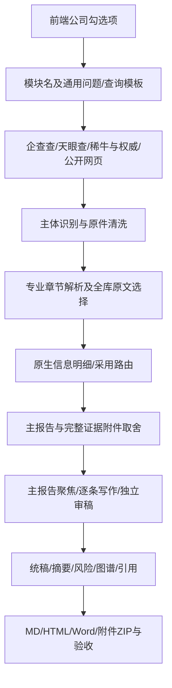
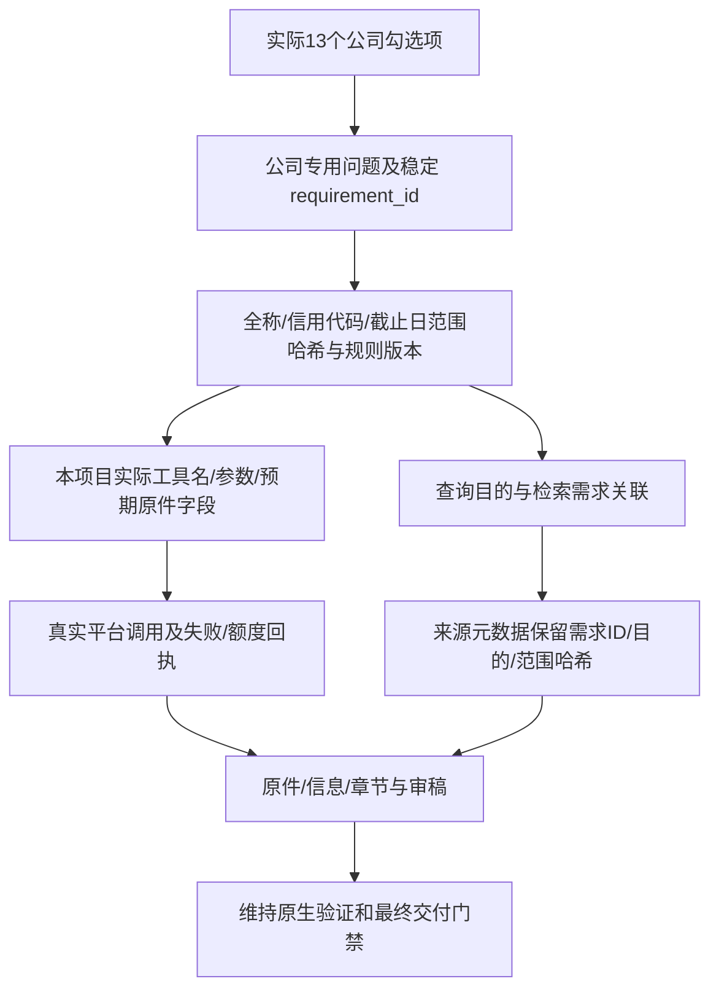

# 现状、已实施变更与待闭合环节

## 已冻结的原链路

原系统已有专业平台和原件优先、14 章结构、双向语义审稿、完整附件、原生恢复回执等能力；本轮不整体替换。原 V148 代码已包含 canonical focus witnesses，但两份旧真实报告没有取得新合约的全部成功回执。

## 本轮已接入

生产落点：`backend/company_requirements.py`、`backend/research_strategies/company.py`；共享工作流只增加公司分支的计划/元数据接入，`backend/company_platform.py` 增加精确工具参数的需求关联。工具实现存在不等于账号或接口当前可用；未实现专门财务报表 API 时使用披露原件，不能把第三方 QCC 项目的示例工具当作本项目已有能力。

研究合同的 state 保留 planned；任何来源、工具返回或范围哈希都不能自动使其成为“问题已回答”。需求数据保留字段、期间、单位、责任主体、相反信息及原文定位要求，原有章节写作和独立复核继续决定是否可采用。

## 本轮恢复与验收控制

冻结 SQLite、原件清单、模型记录、native checkpoint → 逐来源/逐信息去向审计 → 有界原生恢复 → 根据具体失败修复通用逻辑 → 仅回放受影响环节 → 全报告及导出复核。

运行器 `diagnostics/company_phase1_native.py` 将新写入限制于自身运行库，原件可以从已冻结的本任务基线只读读取。它不移植或改写模型答复，仍由生产恢复代码验证回执绑定；旧 V1 focus journal 不作为 V2 通过依据。模型工厂请求通过 semaphore 串行；requests HTTP 至多并发 2。达到本轮调用上限会保存已有原生检查点并明确记录未验收，不能强制接受。

## 仍待实现或核验

- 缺口/冲突驱动的进一步检索、停止条件在实际长期恢复中的验证，以及旧通用补查路由的精细映射。
- 完整关系/事件有效时间、义务主体与章节证据包的最终去向审计；现有 source/content ID 不能替代逐事实采用证明。
- 独立全库审稿发现跨章漏用后，将补证和修订要求回写具体章节的整份真实验证。
- 三个真实样本、全部风险与代表性普通引用的独立抽检、最终导出字节绑定、浏览器实测与 Word 全页检查。

这些项目未闭合前，不能把当前链路图或 13/13 结构探针称作第一阶段完成。
