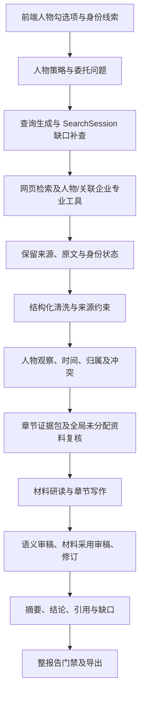
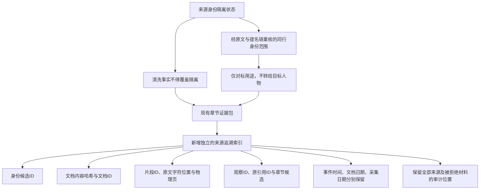

# 链路、迭代与检查点

## 核实的现有链路



实际报告有 15 章。第 2—12 章分别接受正文检查；摘要、结论、来源与待核验计划仍须与全部正文一致。图表示源码路径，不表示每一节点已经通过真实验收。

## 本轮已落地的接入



索引中的章节候选不是实际采用，来源文字匹配不是独立核实；风险结论没有从索引自动计算。前端 requirement_id 已贯通研究问题、身份锚点、工具能力与预期证据。复核页按报告、语料和代码版本绑定记录；浏览器功能验收不替代独立事实复核。

## 轮次记录

| 轮次 | 瓶颈和动作 | 真实结果 | 尚缺的验证 |
|---|---|---|---|
| 基线隔离 | 确认已整合基线、共享补丁 SHA256、独立配置和存储 | 基线 `7cc0752`，共享搜索提交 `b60ea11`；SQLite integrity_check 为 ok | 运行调用与导出仍需逐轮验收 |
| 身份隔离 R1 | 同名来源的隔离可被事实 confirmed 标签覆盖；加入来源约束 | 人物回归 893 passed、5 failed；5 项暴露同行独立身份范围 | 未将失败改写为通过 |
| 身份隔离 R2 | 只允许经过 annotated_facts 原文与提名复核的同行使用独立范围；保留拒绝原因 | 相关回归 28 passed；真实冻结资料仍为王 1128、张 415 条记录 | 当前整报告和引用抽查尚待执行 |
| 共享兼容 | 验证搜索、助手、配置及公司/行业受影响路径 | 第一组 91 passed、1 skipped；兼容组 168 passed | 最终代码版本上的专项和完整必要门禁 |
| 真实入口 R1 | 原接口 qwen3.8-max，模型最多24次；另执行生产入口检索2次、抓原文2次 | 实际模型1次，输出8192 token 后 finish_reason=length，最终正文为空；检索及抓取回执独立保留 | 没有有效模型章节；未新增专业平台成功回执 |
| 真实入口 R2 | 同一模型，将完整材料拆成更小批次，不裁剪证据 | 实际模型1次，HTTP 401 无效令牌 | 密钥/接口未通过，不视为材料或报告通过 |
| 官方接入 R3/R4 | 用户提供国内千问密钥，分别调用 qwen3.8-max 与授权验证用 qwen-flash | 各1次，均 HTTP403 AccessDenied.Unpurchased；官方解释为服务未开通 | 不把错误误判为只有单模型权限，不宣称密钥可用 |
| 新接入 R5 | 用户指定 goaichat 接口，qwen3.8-max 单次真实材料研读 | 1次返回完整 JSON；5个候选判断中3个通过来源约束、2个因日期归属问题拒绝 | 仅第一批材料，后续由单次上限停止，整章未通过 |
| 新接入 R6 | 相同模型继续受影响章节，显式上限24次 | 实际6次：3次返回、2次503、1次连接错误；精确输入复用1次 | 材料研读未完成，保留失败与降级诊断 |
| 备用接入 R7 | 按用户说明尝试 kimitk 备用地址，同一模型与受影响材料 | 实际3次，均连接失败；两个地址的只读鉴权模型列表均返回200且列出 qwen3.8-max | 鉴权和模型列表可用不等于生成稳定；配置恢复到有成功内容回执的主地址 |
| 人物归属 R7/R8 | 明确亲属经历归到其他人员；原文、证据ID保留 | 专项59 passed，人物全量925 passed；张勇415条记录均保留，当前路由387个ID | 代词、混合主语等仍待原文上下文审计 |
| 复核界面 | 实际浏览器操作筛选、原文、导出、导入及版本拒绝 | 425条入口，导出0条事实复核通过记录，旧版本拒绝导入；截图在 ui-qa | 未执行人工整报告或高风险引用验收 |

代码、输入输出、报告和审稿的对应关系以各运行目录的 SHA256 和真实回执为准。没有供应商实际扣费回执时仅记录可取得的 token 用量、调用量与耗时，不编造费用。

## 重放已有离线审计

在本 worktree 内运行；Python 环境可替换为安装本仓库依赖的独立解释器。

```powershell
E:/projects/RAG/.venv/Scripts/python.exe scripts/audit_person_phase1_baseline.py --old-workspace C:/Users/wangli/.codex/worktrees/person-evidence-audit/RAG
$env:PYTEST_DISABLE_PLUGIN_AUTOLOAD='1'
E:/projects/RAG/.venv/Scripts/python.exe -m pytest -q -s -p anyio.pytest_plugin test/test_person_source_identity_veto.py test/test_person_provenance.py test/test_person_reputation_peers.py
```

历史目录只读。首次审计复制输入到本任务冻结区；已有冻结文件内容不一致时审计拒绝覆盖。付费入口必须显式使用相应脚本的 `--live` 或 `--live-model`，不在离线重放中自动触发。
