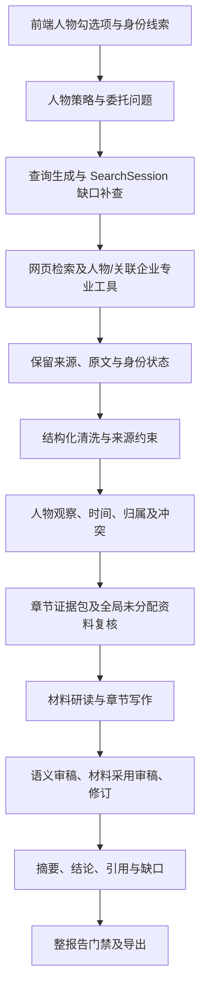
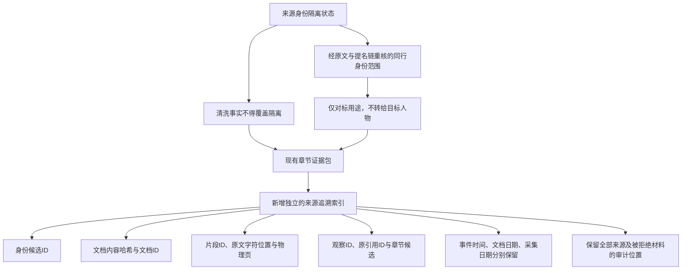

# 链路、迭代与检查点

## 核实的现有链路



实际报告有 15 章。第 2—12 章分别接受正文检查；摘要、结论、来源与待核验计划仍须与全部正文一致。图表示源码路径，不表示每一节点已经通过真实验收。

## 本轮已落地的接入



索引中的章节候选不是实际采用，来源文字匹配不是独立核实；风险结论没有从索引自动计算。前端 requirement_id 到研究问题、身份锚点、工具与预期证据的贯通，以及可使用的人工复核入口，尚在后续实施范围。

## 轮次记录

| 轮次 | 瓶颈和动作 | 真实结果 | 尚缺的验证 |
|---|---|---|---|
| 基线隔离 | 确认已整合基线、共享补丁 SHA256、独立配置和存储 | 基线 `7cc0752`，共享搜索提交 `b60ea11`；SQLite integrity_check 为 ok | 运行调用与导出仍需逐轮验收 |
| 身份隔离 R1 | 同名来源的隔离可被事实 confirmed 标签覆盖；加入来源约束 | 人物回归 893 passed、5 failed；5 项暴露同行独立身份范围 | 未将失败改写为通过 |
| 身份隔离 R2 | 只允许经过 annotated_facts 原文与提名复核的同行使用独立范围；保留拒绝原因 | 相关回归 28 passed；真实冻结资料仍为王 1128、张 415 条记录 | 当前整报告和引用抽查尚待执行 |
| 共享兼容 | 验证搜索、助手、配置及公司/行业受影响路径 | 第一组 91 passed、1 skipped；兼容组 168 passed | 最终代码版本上的专项和完整必要门禁 |
| 真实入口 R1 | 当前模型章节写作/审稿上限24次，生产入口检索2次、最多抓原文2次 | 执行中，真实回执归入本任务 work 目录 | 不用执行中状态冒称报告通过 |

代码、输入输出、报告和审稿的对应关系以各运行目录的 SHA256 和真实回执为准。没有供应商实际扣费回执时仅记录可取得的 token 用量、调用量与耗时，不编造费用。

## 重放已有离线审计

在本 worktree 内运行；Python 环境可替换为安装本仓库依赖的独立解释器。

```powershell
E:/projects/RAG/.venv/Scripts/python.exe scripts/audit_person_phase1_baseline.py --old-workspace C:/Users/wangli/.codex/worktrees/person-evidence-audit/RAG
$env:PYTEST_DISABLE_PLUGIN_AUTOLOAD='1'
E:/projects/RAG/.venv/Scripts/python.exe -m pytest -q -s -p anyio.pytest_plugin test/test_person_source_identity_veto.py test/test_person_provenance.py test/test_person_reputation_peers.py
```

历史目录只读。首次审计复制输入到本任务冻结区；已有冻结文件内容不一致时审计拒绝覆盖。付费入口必须显式使用相应脚本的 `--live` 或 `--live-model`，不在离线重放中自动触发。
